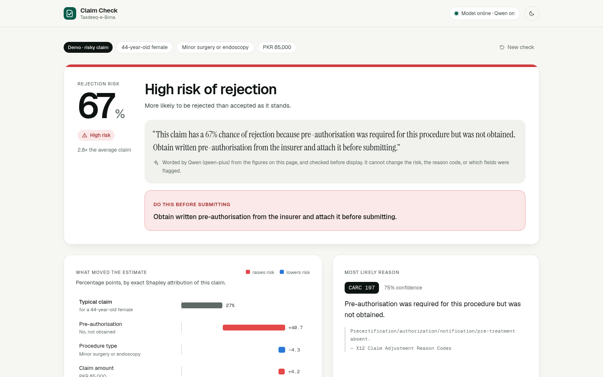
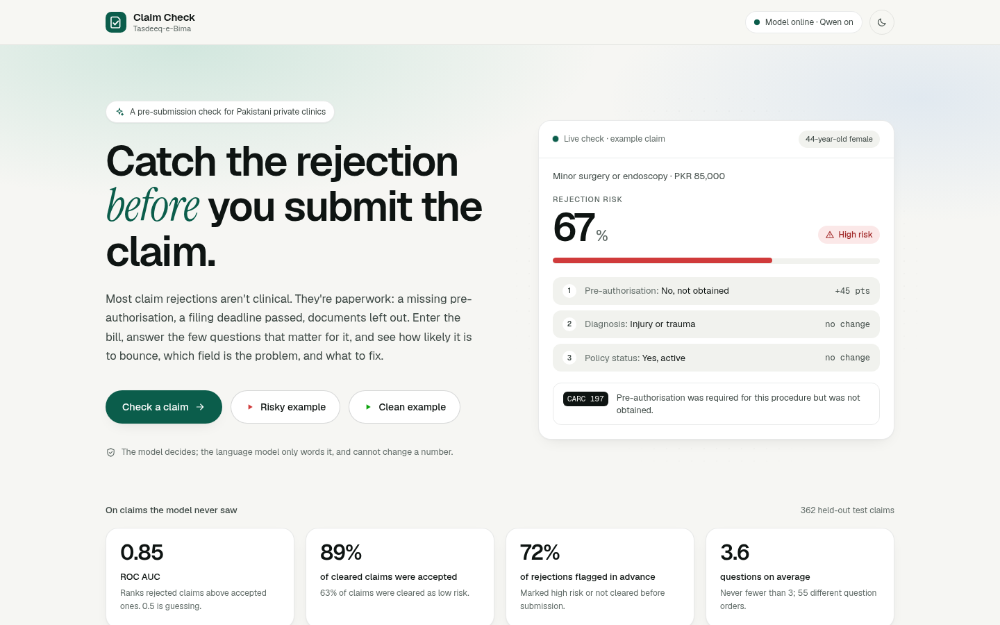
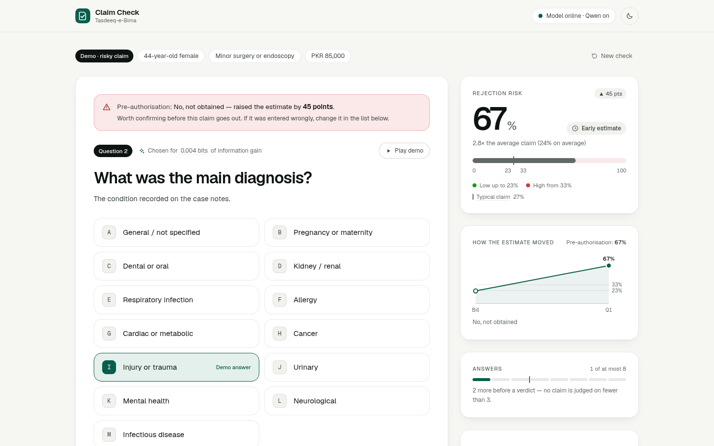
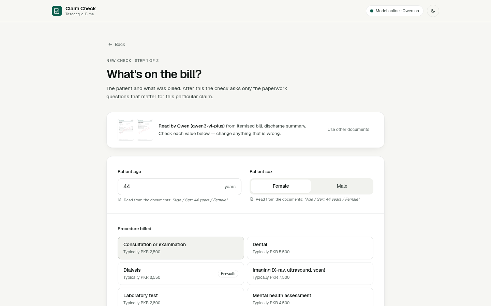
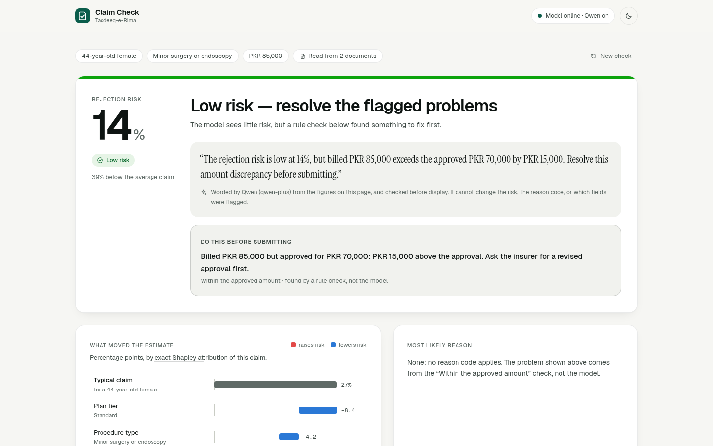
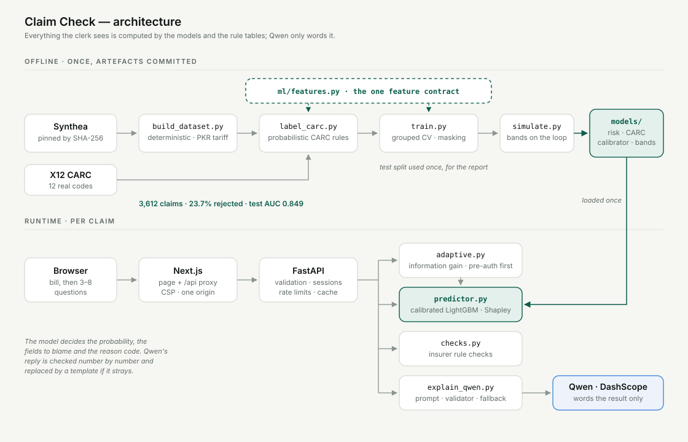

# Claim Check · Tasdeeq-e-Bima

**Catch the insurance rejection before you submit the claim.**

A pre-submission check for private clinics in Pakistan. The clerk photographs the bill and its
papers (or types the bill in); Qwen-VL reads what is printed, the clerk confirms it, and the tool
asks the few paperwork questions the papers can't settle for *that* claim, then says how likely it is to
bounce, which field is the problem, which real industry reason code it would get, and the one
thing to fix. Think spell-check, but for insurance claims.

Built for the Bano Qabil AI hackathon by Mirza Ahsan Baig and Safee Akmal.



---

## The problem

Most claim rejections have nothing to do with whether the treatment was right. They're
paperwork: no pre-authorisation, a missing document, a claim filed past the insurer's deadline.
Pakistani private clinics usually have no dedicated billing specialist, so these mistakes slip
through and the clinic finds out weeks later, when the money doesn't arrive. Enough of that and
clinics quietly raise prices, drop insurance patients, or eat the loss. It's a cash-flow problem
dressed up as a paperwork problem.

## What it does

1. **Start from the documents, or enter the bill.** Upload photos or PDFs of the bill, an
   approval letter, a discharge summary: Qwen-VL reads what is printed — patient, procedure,
   amount, insurer, plan, panel, diagnosis, treatment date — and fills the form, each value shown
   with the words it was read from for the clerk to keep or drop. Every value goes through the
   same validation as typing it. Pre-authorisation is never taken from a document, only
   suggested; the clerk always answers it. Two fictional sample sets are built in for the demo.
2. **Answer what matters.** One question at a time, each chosen because it would remove the most
   uncertainty about *this* claim. If pre-authorisation was required, that is always the first
   question. It stops as soon as the verdict is settled: never before 3 answers, never after 8
   questions. Anything but pre-authorisation can be left as **not sure**; the claim is then never
   called ready to submit until it is answered.
3. **Fix it before it bounces.** A calibrated probability; the fields driving it, with points that
   add up; six insurer-rule checks, plus checks across the uploaded papers (a missing approval or
   discharge summary, an approval for less than was billed, papers that disagree on the patient
   or the dates); the most likely real **X12 CARC** reason code; the one action to take; and a
   one-page summary to print or save as a PDF and file with the claim.
4. **In plain English.** Qwen words the computed result in two sentences. It cannot change a
   number: any reply containing a figure it wasn't given is rejected and a template is used.
5. **Correctable.** Any answer can be changed in place, and staff can flag a verdict as wrong —
   logged as a labelled example, the seed of a real retraining loop.

|  |  |
|---|---|
|  |  |

## The parts doing the real work

**Adaptive questioning, by information gain.** For every open question the engine computes the
mutual information between its answer and the outcome, given everything known so far, by asking
the model what the claim's risk would be under each possible answer. It asks the best one. The
ordering changes with the claim — across 362 held-out claims we see 55 different question
orders — and the full derivation, including the one subtlety that once made gains negative, is in
[`backend/services/adaptive.py`](backend/services/adaptive.py).

**Explaining a specific reason, not a bare score.**
- *Attribution:* exact Shapley values of the calibrated probability over the bill and the
  answers. They carry the sign of each field's real effect and add up exactly from a typical
  claim for that patient to this one — the waterfall on the result page.
- *Rule checks:* pre-authorisation requirement, filing deadline, amount against the typical
  price, plan coverage, diagnosis/procedure fit, procedure/patient fit. Deterministic readings
  of the same rule tables the training data came from ([`ml/features.py`](ml/features.py)).
- *Reason code:* a second model, trained only on rejected claims, predicts which of 13 real X12
  CARC codes applies, choosing only among defects the claim actually shows. It never
  names a reason the answers don't support, and a low-risk claim that still has one is
  told what to fix first rather than called ready to submit.

## Where we landed, honestly

On the held-out test split (362 claims), used once, for this report:

| | |
|---|---|
| ROC AUC, fully answered | **0.849** (0.763 with questions still unanswered) |
| Claims cleared as low risk | 63% of claims — **89% of them were accepted** |
| Claims flagged high risk | 26% of claims — **56% of them were rejected** (base rate 24%) |
| Rejections flagged before submission | **72%** (medium or high) |
| Accuracy at the high-risk line | 81.8%, against a 76.2% "approve everything" baseline |
| Questions per check | 3.6 on average |
| CARC reason code | 83% top-1 across 13 codes (random: 8%), on claims it never trained on |

We report verdict quality and AUC first because accuracy flatters on imbalanced data. We hold
accuracy in the 70–85% band on purpose: on data we labelled ourselves, a near-perfect score would
only prove the model had reverse-engineered our rules. The reason-code accuracy is high for the
same reason — our codes follow our rules more consistently than any real insurer's do — and the
[model card](docs/model-card.md) says so. Every figure there is regenerated from the committed
artefacts and checked against what training recorded.

## Why the data is synthetic

There is no public dataset of real clinic claims paired with real outcomes — insurers and TPAs
treat it as private, and every commercial player trains on its own claims. So we built ours from:

- **[Synthea](https://github.com/synthetichealth/synthea)**, MITRE's open-source patient
  simulator — medically coherent diagnoses, procedures and encounters, real SNOMED CT codes —
  pinned by checksum and re-priced per procedure category to believable Pakistani clinic rates;
- **X12 CARC codes**, the real industry list of reasons a claim is denied, verified against
  X12's published list.

The accept/reject outcomes come from our own probabilistic rules engine, with noise, so the model
has to learn patterns rather than memorise a table. The insurer names are invented: we have no
data on how any real Pakistani insurer adjudicates. Full write-up:
[`docs/data-provenance.md`](docs/data-provenance.md).

## Architecture



```
ml/          feature contract, deterministic dataset build, labeller, training, simulation
backend/     FastAPI: sessions, validation, the question engine, attribution, rule checks, Qwen
frontend/    Next.js: landing, intake, live check, verdict; same-origin /api proxy
models/      committed artefacts + metadata.json (metrics, priors, bands)
data/        CARC code table; the labelled dataset (committed)
tests/       74 Python tests; frontend/lib/__tests__ has 12 UI client tests
docs/        model card, provenance, demo script, deployment runbook, deck, screenshots
```

- **Risk model:** LightGBM, trained on claims with random fields hidden so it handles a
  half-answered claim; hyperparameters by grouped cross-validation; centred isotonic
  calibration on out-of-fold predictions.
- **Bands and stopping:** fitted on validation by simulating the real question loop, under
  explicit constraints (a "low" verdict right ≥ 85% of the time, "high" meaning more likely
  rejected than not, both either side of the average claim).
- **Reason model:** LightGBM multiclass on rejected claims with an identifiable cause.
- **Explanation:** Qwen (`qwen-plus`) on Alibaba Cloud DashScope, OpenAI-compatible API.
- **Documents:** Qwen-VL (`qwen3-vl-plus`) reads uploaded photos and PDFs into the check's own
  fields; files are re-encoded in memory, never stored, and names and ID numbers are never kept.
- **No database, no auth.** Sessions live in memory, bounded and expiring. The feedback log
  is the one thing persisted.

## Running it

Needs Python 3.12 with [uv](https://docs.astral.sh/uv/), and Node 20+. The trained models and
the labelled dataset are committed, so nothing has to be downloaded or trained first.

```bash
uv sync --frozen --all-extras             # exactly the versions in uv.lock
cp .env.example .env                      # optional: DashScope key for Qwen
uv run python scripts/test_dashscope.py   # optional: confirms Qwen end to end

uv run uvicorn backend.main:app --port 8000 --no-proxy-headers   # API -> :8000
cd frontend && npm ci && npm run dev                 # UI   -> :3000 (proxies /api to :8000)
```

Open <http://localhost:3000>. Without a DashScope key everything works; the plain-English line
comes from the built-in template instead of Qwen. Set `API_URL` if the API isn't on
`127.0.0.1:8000`.

**Tests**

```bash
uv run pytest -q                 # 112 tests, offline: never calls Qwen or touches feedback.db
uv run pytest -q -m live         # one real Qwen call, if .env is filled in
cd frontend && npm run typecheck && npm run lint && npm test
```

**Rebuilding the data and models** (only if you change the pipeline):

```bash
uv run python scripts/fetch_synthea.py    # pinned bundle, SHA-256 verified
uv run python ml/build_dataset.py && uv run python ml/label_carc.py
uv run python ml/train.py                 # ~3 minutes
uv run python ml/evaluate.py              # regenerates docs/model-card.md
uv run --extra deck python docs/build_deck.py
```

Every step is deterministic. CI rebuilds from scratch weekly and fails if the dataset isn't
byte-identical or the metrics drift past tolerance.

**Containers:** `docker compose --env-file .env up --build`. The API image ships the committed
models and runs the test suite as a build stage; both containers run as non-root and bind to
localhost. The ECS runbook, nginx and TLS setup are in [`docs/deployment.md`](docs/deployment.md).

## Two demo claims, on purpose

The landing page offers two scripted claims that autoplay through the *same* question loop as a
blank check — only the answers are scripted:

- **Risky:** a PKR 85,000 minor surgery. Pre-authorisation is required, so it's asked first; the
  answer is "no", and the estimate jumps from 22% to 67%. Verdict after three questions: high
  risk, CARC 197, "obtain written pre-authorisation and attach it".
- **Clean:** a PKR 2,500 consultation. Pre-authorisation isn't needed, so it's never asked;
  three questions later it's cleared at 18%, with no reason code.

So it's obvious the tool doesn't flag everything it sees.

## What we cut, on purpose

Urdu output (the Qwen layer takes the language as a parameter, so it's a small add-back); auth,
accounts and a database; live retraining. This is a demo, and the places where a real product
would need more are written down rather than papered over — real outcomes from a partner clinic,
parsed 835 remittance files, and per-insurer models and rule tables.

## Where everything is documented

| | |
|---|---|
| [`docs/model-card.md`](docs/model-card.md) | Every number: verdict quality, calibration, confusion matrix, per-code accuracy, limitations |
| [`docs/data-provenance.md`](docs/data-provenance.md) | Exactly what's real (Synthea, X12) and what's ours (prices, labels) |
| [`docs/demo-script.md`](docs/demo-script.md) | The 3-minute walkthrough, with answers to the questions judges ask |
| [`docs/deployment.md`](docs/deployment.md) | Containers, ECS, nginx, TLS, and what must change before real data |
| [`docs/project-description.md`](docs/project-description.md) | The written submission |
| `docs/deck.pdf` / `docs/deck.pptx` | 9 slides, generated from `docs/build_deck.py` with figures read from the model |
| [`IMPLEMENTATION_PLAN.md`](IMPLEMENTATION_PLAN.md) | The build log — every phase, every problem found and fixed |
| [`CLAUDE.md`](CLAUDE.md) | Working guide for the codebase: layout, commands, guardrails |
